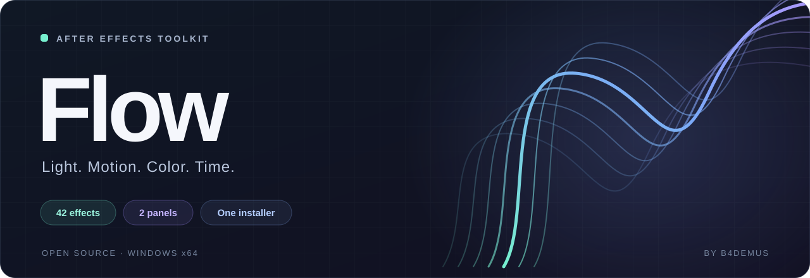

<p align="center">
  
</p>

<p align="center">
  <b>Русский</b> · <a href="README.en.md">English</a>
</p>

<p align="center">
  <a href="https://github.com/b4demus/Flow/releases/latest"></a>
  
  
  
  <a href="LICENSE"></a>
</p>

<p align="center">
  <a href="https://github.com/b4demus/Flow/releases/latest/download/Flow-Setup.exe"><b>Скачать установщик</b></a> ·
  <a href="https://github.com/b4demus/Flow/releases/latest">Релиз и ZIP</a> ·
  <a href="#установка">Установка</a> ·
  <a href="#состав">Состав</a> ·
  <a href="#сборка-из-исходников">Сборка</a>
</p>

# Flow

**42 эффекта, две панели, один набор для Adobe After Effects.**

Свечение и лучи, тряска камеры, цветовые искажения, плёночные дефекты, работа со временем и кривыми анимации. Flow объединяет нативные плагины `.aex` и панели ScriptUI в одном установщике для Windows x64.

| Инструмент | Для чего |
| :--- | :--- |
| **Flow FX** · 41 эффект | Свет, движение, цвет, стилизация и переходы. Имена эффектов начинаются с `F_`. |
| **Flowtime** · 1 эффект | Замедление, изменение скорости и промежуточные кадры на основе оптического потока. |
| **Flowcut** · панель | Удаление повторяющихся кадров в аниме и лимитированной анимации перед ретаймингом. |
| **FlowCurves** · панель | Редактор Bézier easing: ручки кривой, готовые и собственные пресеты, применение к ключам. |

> **Статус: preview для Windows x64.** Рендеринг выполняется на CPU. PixelSort и PixelMosh ещё развиваются, WarpTransform экспериментальный. Flowtime поддерживает 8/16 bpc; GPU и 32 bpc пока не реализованы. Подробнее: [статус эффектов](fx/docs/status.md) и [Flowtime](time/README.md).

## Установка

1. Скачай [**Flow-Setup.exe**](https://github.com/b4demus/Flow/releases/latest/download/Flow-Setup.exe).
2. Сохрани проект и закрой After Effects и другие приложения Adobe.
3. Запусти установщик, нажми **Установить** и подтверди запрос прав администратора.
4. Открой After Effects: эффекты находятся в меню **Effect → Flow …**, панели — **Window → Flowcut.jsx / FlowCurves.jsx**.

EXE содержит весь набор: скачивать ZIP отдельно не нужно. Rust и инструменты сборки для установки не нужны. Интерфейс установщика — на русском.

Для сохранения собственных пресетов FlowCurves включи **Preferences → Scripting & Expressions → Allow Scripts to Write Files and Access Network**.

<details>
<summary><b>ZIP, пути установки и проверка пакета</b></summary>

Скачай ZIP со [страницы релиза](https://github.com/b4demus/Flow/releases/latest), распакуй его **целиком** и запусти `install.cmd`.

Проверить пакет и увидеть план изменений без установки:

```powershell
powershell.exe -NoProfile -ExecutionPolicy Bypass -File .\install.ps1 -Check
```

| Компонент | Куда устанавливается |
| :--- | :--- |
| Все 42 плагина `.aex` | `C:\Program Files\Adobe\Common\Plug-ins\7.0\MediaCore\Flow` |
| Обе панели `.jsx` | `Support Files\Scripts\ScriptUI Panels` каждой найденной After Effects |
| Резервные копии заменённых файлов | `C:\ProgramData\Flow\Backups` |

Перед изменениями установщик проверяет SHA-256 и внутренние идентификаторы плагинов, сохраняет заменяемые файлы и откатывает изменения при сбое. Повторная установка того же пакета не создаёт дубликаты и лишние резервные копии.

Контрольные суммы доступны в релизе: `Flow-Setup.exe.sha256` для EXE и `SHA256SUMS.txt` для содержимого `dist/`.

</details>

## Состав

| Категория в After Effects | Количество | Что внутри |
| :--- | ---: | :--- |
| **Flow Adjust** | 2 | Двухцветное тонирование и выделение ярких областей |
| **Flow Blur and Sharpen** | 2 | Размытие движения и резкость |
| **Flow Distort** | 4 | Тряска, геометрические и хроматические искажения |
| **Flow Lighting** | 8 | Свечение, лучи, блики и подсветка краёв |
| **Flow Stylize** | 6 | Плёнка, цифровые дефекты, PixelSort, PixelMosh и виньетка |
| **Flow Time** | 18 | Flowtime, мерцание, стоп-кадр, реверс и временные сдвиги |
| **Flow Transitions** | 2 | Переходы с размытием и тряской |

<details>
<summary><b>Все 42 эффекта по именам</b></summary>

| Категория | Эффекты |
| :--- | :--- |
| Adjust | `F_DuoTone`, `F_Hotspots` |
| Blur and Sharpen | `F_BlurMoCurves`, `F_Sharpen` |
| Distort | `F_DistortRGB`, `F_Shake`, `F_WarpChroma`, `F_WarpTransform` |
| Lighting | `F_EdgeRays`, `F_Glint`, `F_Glow`, `F_GlowDarks`, `F_GlowEdges`, `F_GlowRainbow`, `F_LensFlare`, `F_Rays` |
| Stylize | `F_DigitalDamage`, `F_FilmDamage`, `F_FilmEffect`, `F_PixelMosh`, `F_PixelSort`, `F_Vignette` |
| Time | `Flowtime`, `F_Flicker`, `F_FlickerMatch`, `F_FlickerMatchColor`, `F_FlickerMatchMatte`, `F_FlickerMchMatteColor`, `F_FlickerRemove`, `F_FlickerRemoveColor`, `F_FlickerRemoveMatte`, `F_FlickerRmMatteColor`, `F_FreezeFrame`, `F_GetFrame`, `F_JitterFrames`, `F_RandomEdits`, `F_ReverseClip`, `F_ReverseEdits`, `F_TimeAverage`, `F_TimeWarpRGB` |
| Transitions | `F_DissolveBlur`, `F_DissolveShake` |

</details>

## Быстрый старт

- **Свет и стиль:** примени `F_Glow`, `F_Rays` или `F_FilmEffect` к слою через меню **Effect → Flow …**.
- **Замедление:** добавь **Flow Time → Flowtime**, укажи частоту исходника в `Input: Frame Rate` и поставь `Speed % = 25` для замедления в четыре раза.
- **Убрать дубли:** выдели видеослой, открой **Flowcut**, начни с порога `6` и нажми **Вырезать дубли**. Панель сжимает повторяющиеся рисунки и сокращает длительность слоя; после этого можно применять ретайминг.
- **Настроить easing:** выдели ключи, открой **FlowCurves**, выбери пресет или задай кривую и нажми **Apply**.

## Переход с прежних проектов

| Прежний проект | В составе Flow |
| :--- | :--- |
| Facet | Flow FX: прежние имена `F_…`, категории `Flow …` |
| Flowtime | Flowtime в категории **Flow Time** |
| Dedupe | Flowcut |
| ezcurves | FlowCurves |

**Проекты со старыми эффектами Facet требуют ручного переноса.** Их внутренние идентификаторы изменились с `B4DM Facet …` на `B4DM Flow …`, поэтому AE покажет прежние эффекты как отсутствующие. Перед обновлением сохрани отдельную копию проекта: эффекты нужно добавить заново и перенести настройки.

Установщик убирает узнаваемые старые файлы Facet, Flowtime, Dedupe и ezcurves с резервным копированием. Порог Dedupe, состояние и пресеты ezcurves переносятся автоматически. Flowcut узнаёт слои, обработанные Dedupe, и умеет их восстановить.

## Сборка из исходников

Нужны **Windows x64**, **Rust stable с хостом `x86_64-pc-windows-gnu`**, **MinGW-w64** с `windres` и **.NET Framework 4.x** с C#-компилятором для установщика.

```powershell
git clone https://github.com/b4demus/Flow.git
cd Flow
powershell.exe -NoProfile -ExecutionPolicy Bypass -File .\build.ps1
```

Скрипты используют `cargo` из `PATH`. Для портативной среды можно указать `PETAL_TOOLCHAIN`; ожидаемая структура — `cargo/`, `rustup/`, `gcc/w64devkit/`. Также автоматически проверяется `../.tools/rust-daw` относительно корня Flow.

Сборка создаёт плагины и панели в `dist/`, манифест `bundle.json`, контрольные суммы, `work/Flow-<version>.zip` и `Flow-Setup.exe`. CLI остаются в `fx/dist/` и `time/dist/`. Повторная упаковка готовых бинарников:

```powershell
powershell.exe -NoProfile -ExecutionPolicy Bypass -File .\build.ps1 -SkipRust
```

Проверка установщика на изолированных копиях Adobe-папок:

```powershell
powershell.exe -NoProfile -ExecutionPolicy Bypass -File .\tools\test_installer.ps1
```

Тесты используют `work/installer-tests/`. Дополнительные команды проверки ядра — в документации [Flow FX](fx/README.md) и [Flowtime](time/README.md).

## Исходники и документация

```text
Flow/
├── fx/           41 эффект, Rust-ядро, AE-интеграция и CLI
├── time/         Flowtime: оптический поток, ретайминг и CLI
├── cut/          Flowcut: анализ и удаление повторяющихся кадров
├── curves/       FlowCurves: Bézier easing и пресеты
├── installer/    общий установщик на PowerShell и C#
├── tools/        упаковка и тесты установщика
├── docs/assets/  оформление README
└── build.ps1     сборка всего набора
```

[Flow FX](fx/README.md) · [Flowtime](time/README.md) · [Flowcut](cut/README.ru.md) · [FlowCurves](curves/README.md) · [Сообщить о проблеме](https://github.com/b4demus/Flow/issues)

Документация отдельных компонентов сохраняет историю прежних проектов. Актуальные инструкции по установке всего набора находятся в этом README.

## Лицензия

[MIT](LICENSE) · © 2026 b4demus. Сторонние компоненты сохраняют собственные условия: [Independent JPEG Group](third_party/ijg/README), [заметки об адаптации](third_party/ijg/FLOW.md), [уведомления](installer/THIRD-PARTY-NOTICES.txt).

This software is based in part on the work of the Independent JPEG Group.
