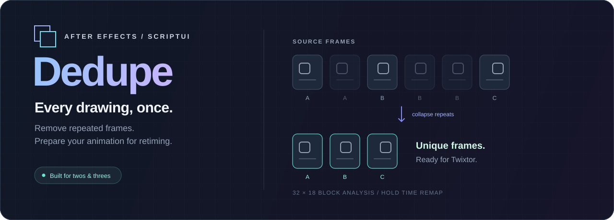

<div align="center">



[English](README.md) · **Русский**


**Уберите повторы. Оставьте рисунки. Подготовьте клип к ретаймингу.**

Небольшая ScriptUI-панель для Adobe After Effects: удаляет повторяющиеся кадры в аниме и ограниченной анимации, чтобы инструменты оптического потока вроде Twixtor работали с уникальными рисунками.

[Установка](#установка) · [Работа с панелью](#работа-с-панелью) · [Как это устроено](#как-это-устроено)

</div>

## Что делает Flowcut

В анимации «на двойках» и «на тройках» один рисунок занимает несколько видеокадров. Flowcut сравнивает каждый кадр с последним оставленным, удаляет почти одинаковые и раскладывает оставшиеся исходные кадры подряд через hold-ключи Time Remap.

```text
Было      A A B B B C C D D D
Осталось  A   B     C   D
Результат A B C D             → можно делать ретайминг
```

| Возможность | Поведение |
| --- | --- |
| Пакетная обработка | Обрабатывает выделенные видеослои за один запуск. |
| Настройка порога | Чувствительность от **1 до 40**, по умолчанию **6**. |
| Восстановление | Выключает Time Remap, созданный Flowcut, и возвращает исходную точку выхода слоя. |
| Повторный запуск | Сначала восстанавливает уже обработанный слой, затем анализирует его заново. |
| Один шаг Undo | Весь запуск обработки объединён в одну операцию отмены After Effects. |
| Средствами AE | Для анализа используются эффекты и выражения After Effects; отдельная программа анализа кадров не нужна. |

## Установка

Flowcut входит в набор **Flow** и ставится его установщиком (`Flow-Setup.exe` в корне набора): панель
копируется в `ScriptUI Panels` каждой найденной After Effects, а прежний `Flowcut.jsx` убирается.
После перезапуска AE: **Window → Flowcut.jsx**. Вручную: скопировать `Flowcut.jsx` в
`C:\Program Files\Adobe\Adobe After Effects <версия>\Support Files\Scripts\ScriptUI Panels\`
или запустить разово через **File → Scripts → Run Script File…**.

Слои, обработанные прежней панелью Flowcut (комментарий `[flowcut out=…]`), Flowcut узнаёт и умеет вернуть.

## Работа с панелью

1. Откройте композицию и выделите один или несколько видеослоёв.
2. Начните с порога **6** и нажмите **Вырезать дубли**.
3. Flowcut проанализирует исходные кадры в пределах in/out каждого слоя, создаст hold-ключи Time Remap и укоротит слой до количества оставшихся кадров.
4. Примените Twixtor или другой инструмент ретайминга к результату. При необходимости сначала сделайте прекомпозицию.
5. Чтобы восстановить выделенные обработанные слои, нажмите **Вернуть**.

### Как подобрать порог

Порог задаёт допустимое изменение среднего цвета блока в уровнях **0–255**. Кадр сохраняется, если наибольшее различие по блокам и цветовым каналам превышает порог.

| Что происходит | Что изменить |
| --- | --- |
| Удаляются отличающиеся рисунки | **Уменьшите** порог: панель будет сохранять более мелкие изменения. |
| Из-за шума или сжатия остаются повторы | **Увеличьте** порог: панель будет игнорировать больше небольших отличий. |

Настройка сохраняется между сеансами. Перед обработкой длинного клипа проверьте результат на коротком фрагменте.

## Как это устроено

1. Временные композиции **Flowcut diff** и **Flowcut probe** сравнивают текущий кадр с последним оставленным исходным кадром.
2. **Mosaic** сводит сравнение к сетке **32 × 18** со средними значениями по блокам.
3. **Difference** и **Levels** выделяют изменения выше порога.
4. Выражение с `sampleImage` считывает результат. Сравнение с последним оставленным кадром позволяет накапливать плавные изменения, а не терять их целиком.
5. Оставшиеся кадры становятся последовательными hold-ключами Time Remap с частотой кадров целевой композиции. Временные композиции анализа удаляются.

Исходный файл не меняется. Flowcut изменяет Time Remap, точку выхода и комментарий выделенного слоя; в комментарии хранится метка восстановления `[flowcut out=…]`.

## Ограничения

- **Тайминг меняется.** Длинная статичная пауза схлопывается в один кадр. Flowcut укорачивает слой, не сохраняет исходный тайминг, не ретаймит звук и не меняет длительность композиции.
- **Движение камеры считается изменением.** При панораме каждый кадр может отличаться, даже если рисунок персонажа повторяется.
- **Эффекты и маски слоя не участвуют.** Анализируется источник до эффектов и масок этого слоя. Если источник — прекомпозиция, её внутренний отрисованный результат входит в анализ.
- **Существующий ретайминг защищён.** Слои с чужим Time Remap или Stretch, отличным от 100%, пропускаются.
- **Для восстановления нужна метка.** Сохраняйте `[flowcut out=…]` в комментарии слоя, если хотите пользоваться кнопкой **Вернуть**.
- **Анализ занимает время.** Обработка выполняется внутри After Effects; скорость зависит от размера и длительности исходника, а также от компьютера.

Flowcut удаляет повторы. Для создания промежуточных кадров нужен отдельный инструмент ретайминга.

## Тесты

### Логика · Windows

Тестовый скрипт извлекает ES3-ядро из `Flowcut.jsx`, проверяет компиляцию всего файла в JScript, выбор кадров, повторяющиеся рисунки с шумом и плавное изменение изображения.

Нужны **Windows PowerShell 5.1**, `cscript` и локальная последовательность минимум из **40** подряд идущих кадров TIFF, PNG или JPG. Проверка реального видео предполагает, что при пороге 6 все кадры различаются. Исходная тестовая последовательность в репозиторий не включена.

Из корня репозитория:

```powershell
powershell.exe -NoProfile -ExecutionPolicy Bypass -File .\tests\run_tests.ps1 -Frames "C:\path\to\frames"
```

### Внутри After Effects

`tests/ae_test.jsx` проверяет ключи Time Remap, длину слоя, удаление временных композиций, повторную обработку и восстановление на сгенерированной анимации.

> **Сначала сохраните работу:** тест закрывает текущий проект After Effects **без сохранения** и создаёт новый тестовый проект. Включите **Allow Scripts to Write Files and Access Network**, чтобы тест мог записать лог.

Запустите его через **File → Scripts → Run Script File…**. Результаты появятся в `tests/ae_test_log.txt`. Дополнительные проверки реального видео выполняются только при наличии соседнего каталога `../flowtime_compare_data/src_anime/frame_0000.tif`.

```text
cut/
├── Flowcut.jsx            # панель, анализ кадров и Time Remap
├── README.md  README.ru.md
├── docs/assets/banner.svg # иллюстрация
└── tests/
    ├── run_tests.ps1      # проверка логики на внешних кадрах
    └── ae_test.jsx        # интеграционная проверка в After Effects
```
