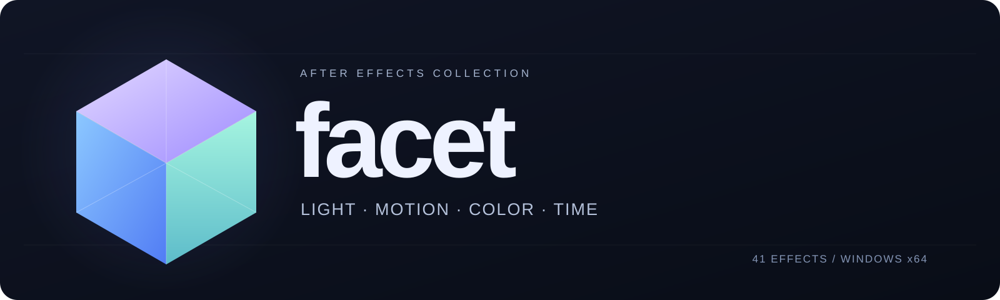

> **Часть набора Flow.** Эта папка — бывший проект Facet; в наборе он называется Flow (эффекты F_…, категории Flow …).
> Ставится общим установщиком из корня набора (см. [README](../README.md)). Ниже описание на момент выхода как Facet;
> ссылки и имена установщика (Facet-Setup, INSTALL.md) относятся к прежнему отдельному пакету, его установщик из этой папки убран.

<p align="center">
  
</p>

<p align="center">
  
  
  
  
  
</p>

<p align="center">
  <b>Русский</b> · <a href="README.en.md">English</a><br />
  <a href="https://github.com/b4demus/facet/releases/download/v0.1.0-preview.20261021/Facet-Setup-2026-10-21.exe">Скачать установщик</a> · <a href="https://github.com/b4demus/facet/releases/tag/v0.1.0-preview.20261021">Релиз и ZIP</a> · <a href="INSTALL.md">Установка</a> · <a href="docs/status.md">Статус сборки</a>
</p>

# Facet

**41 эффект для After Effects — свет, движение, цвет и время в одном наборе.**

Facet объединяет свечение и лучи, тряску и геометрию, временные эффекты,
плёночную стилизацию и цифровые искажения. Эффекты доступны в меню **Facet ...**
под именами `F_`. В набор входят нативные `.aex`, CLI для работы с изображениями
и установщик с обновлением и откатом.

## Начать работу

1. Скачай [**Facet Setup**](https://github.com/b4demus/facet/releases/download/v0.1.0-preview.20261021/Facet-Setup-2026-10-21.exe) из [релиза](https://github.com/b4demus/facet/releases/tag/v0.1.0-preview.20261021).
2. Сохрани проект и закрой After Effects.
3. Запусти EXE, нажми **«Установить»** и подтверди запрос Windows.
4. Открой AE и найди категории **Facet Lighting**, **Facet Time**, **Facet Stylize** и другие.

В EXE уже находится весь набор — отдельный ZIP не нужен.
Для ручной установки распакуй ZIP целиком и запусти `install.cmd`.
Подробнее: [установка и откат](INSTALL.md).

## Внутри набора

| Направление | Для чего |
|---|---|
| **Light** | Свечение, цветные ореолы, блики, лучи и подсветка границ |
| **Motion** | Тряска камеры, размытие движения, RGB-смещения и геометрия |
| **Color** | Дуотон, выделение ярких областей и цветовая обработка |
| **Time** | Стоп-кадры, реверс, временные сдвиги каналов и работа с мерцанием |
| **Texture** | Плёночные дефекты, зерно, цифровые повреждения, PixelSort и PixelMosh |
| **Transitions** | Переходы с тряской и размытием |

<details>
<summary><b>Полный каталог — 41 эффект</b></summary>

| Категория в AE | Количество | Эффекты |
|---|---:|---|
| Facet Adjust | 2 | `F_DuoTone`, `F_Hotspots` |
| Facet Blur and Sharpen | 2 | `F_BlurMoCurves`, `F_Sharpen` |
| Facet Distort | 4 | `F_DistortRGB`, `F_Shake`, `F_WarpChroma`, `F_WarpTransform` |
| Facet Lighting | 8 | `F_EdgeRays`, `F_Glint`, `F_Glow`, `F_GlowDarks`, `F_GlowEdges`, `F_GlowRainbow`, `F_LensFlare`, `F_Rays` |
| Facet Stylize | 6 | `F_DigitalDamage`, `F_FilmDamage`, `F_FilmEffect`, `F_PixelMosh`, `F_PixelSort`, `F_Vignette` |
| Facet Time | 17 | `F_Flicker`, `F_FlickerMatch`, `F_FlickerMatchColor`, `F_FlickerMatchMatte`, `F_FlickerMchMatteColor`, `F_FlickerRemove`, `F_FlickerRemoveColor`, `F_FlickerRemoveMatte`, `F_FlickerRmMatteColor`, `F_FreezeFrame`, `F_GetFrame`, `F_JitterFrames`, `F_RandomEdits`, `F_ReverseClip`, `F_ReverseEdits`, `F_TimeAverage`, `F_TimeWarpRGB` |
| Facet Transitions | 2 | `F_DissolveBlur`, `F_DissolveShake` |

</details>

## Установка без дубликатов

Установщик проверяет SHA-256 файлов и внутренние идентификаторы плагинов,
собирает обновлённые эффекты в одной папке и сохраняет прежние файлы для отката.
Старые имена файлов распознаются; повторная установка актуальной версии
не создаёт дополнительных копий. Открытые Adobe-приложения автоматически
не закрываются.

```text
C:\Program Files\Adobe\Common\Plug-ins\7.0\MediaCore\Facet
```

Резервные копии находятся в `C:\ProgramData\Facet\Backups`.
Пошаговая инструкция: [INSTALL.md](INSTALL.md).

## Текущий статус

Это **предварительная сборка для Windows x64**, проверенная в **AE 2023**.
Рендер выполняется на CPU через SmartFX; на больших кадрах отдельные эффекты
могут работать медленно.

- **57** тестов ядра прошли.
- **13** сценариев установки и отката прошли в Windows PowerShell 5.1.
- PixelSort и PixelMosh ещё дорабатываются; WarpTransform экспериментальный.
- Набор линз, отдельные плёночные функции и режимы размытия пока ограничены.

Подробности без завышенных обещаний: [статус эффектов](docs/status.md).

## Разработка

Ядро написано на **Rust**. Обвязка AE использует SmartFX, а установщик —
PowerShell и C#/.NET Framework. Для проверенной сборки используются
Windows x64, Rust GNU и GCC/MinGW-w64 с `windres`.

```powershell
# Собрать 41 AEX и CLI в dist/
powershell.exe -NoProfile -ExecutionPolicy Bypass -File build.ps1

# Проверить ядро
cargo test --locked -p facet-core

# Сформировать данные пакета и проверить установщик на изолированных папках
python tools/write_installer_manifest.py
powershell.exe -NoProfile -ExecutionPolicy Bypass -File tools/test_installer.ps1
```

`tools/env.ps1` использует настроенный в PATH toolchain или локальный переносной
toolchain через `PETAL_TOOLCHAIN`. Для готового EXE Rust не требуется.

| Папка | Содержание |
|---|---|
| `core/` | Обработка изображений, цвета, геометрии и времени |
| `ae/` | Плагины и общая интеграция After Effects |
| `cli/` | Обработка изображений, сравнение и диагностические команды |
| `installer/` | Проверка пакета, обновление, резервное копирование и UI |
| `tools/` | Сборка, упаковка и проверки установки |
| `third_party/` | Уведомления и условия сторонних компонентов |

## Лицензии

Код проекта — [MIT](LICENSE). Для сторонних компонентов действуют их
собственные условия: [IJG](third_party/ijg/README),
[примечания об адаптации](third_party/ijg/FACET.md).

This software is based in part on the work of the Independent JPEG Group.
