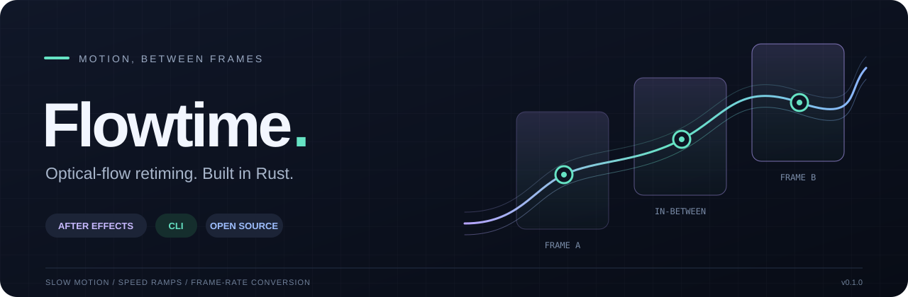

<div align="center">



**Smooth slow motion, speed control, and in-between frames.**<br>
An After Effects plugin and CLI sharing an optical-flow engine written in Rust.

[](Cargo.toml)
[](https://www.rust-lang.org/)
[](#build)
[](#install-in-after-effects)
[](LICENSE)

[Русский](README.md) · **English**

[Features](#features) · [Build](#build) · [Installation](#install-in-after-effects) · [CLI](#cli) · [Documentation](#documentation)

</div>

---

Flowtime synthesizes in-between frames from motion between source images. Use it for slow motion, animated speed changes, and frame-rate conversion — inside After Effects or when processing image sequences from the command line.

**Status: v0.1.0, early development.** The primary build target is Windows x64. The engine runs on the CPU; current limitations are listed below.

## Features

| | What Flowtime offers |
| :--- | :--- |
| **Retiming** | `Speed %` and `Frame Num` modes, animated speed in AE, and separate input/output frame rates. |
| **Optical flow** | Five quality levels, including disabled vectors, image preparation, and motion caching. |
| **Interpolation** | `Nearest`, `Blend`, and `Motion Weighted Blend`; four warping modes, including `Inverse w/ Smart Blend`. |
| **Layers** | Background + up to three foreground layers separated by mattes, per-layer sensitivity, and `Inv Matte Shrink`. |
| **Motion control** | Up to 12 track points per layer, alternate color/motion sources, and cut markers. |
| **After Effects** | 8 and 16 bpc, multi-frame rendering, source/per-layer previews, and track-point overlays. |
| **CLI** | PNG, JPEG, and TIFF input; PNG output; synthetic sequences, contact sheets, and PSNR/SSIM scoring. |

Motion blur compensation is implemented for speed-ups. The core uses DIS optical flow, bidirectional motion estimation, and parallel processing through Rayon.

## Build

You need Git, **Rust stable with the `x86_64-pc-windows-gnu` host**, and **MinGW-w64** (for example, w64devkit). Run the following commands in PowerShell.

```powershell
git clone https://github.com/b4demus/flowtime.git
cd flowtime
powershell -ExecutionPolicy Bypass -File .\build.ps1
```

The script uses `cargo` from `PATH`. For a portable toolchain, it also checks `PETAL_TOOLCHAIN`, then `..\.tools\rust-daw`. The expected portable layout is `cargo\`, `rustup\`, and `gcc\w64devkit\`.

Build output:

```text
dist/
├── Flowtime.aex   # After Effects plugin
└── flowtime.exe   # command-line tool
```

## Install in After Effects

After building, run this command from the repository root:

```powershell
.\install.cmd
```

The installer requests administrator privileges and copies `dist\Flowtime.aex` to Adobe's shared plugin directory:

```text
C:\Program Files\Adobe\Common\Plug-ins\7.0\MediaCore\Flowtime
```

Restart After Effects. Find the effect under **Effect → Time → Flowtime**.

To make a clip four times slower, apply the effect, set `Input: Frame Rate` to the source frame rate, and set `Speed % = 25`. Animate `Speed %` for speed ramps, or select `Time Remap Mode → Frame Number` to control the source position directly.

## CLI

### Slow down to 25%

```powershell
.\dist\flowtime.exe .\input .\output --speed 25 --quality best --warp smart
```

The input directory must contain at least two frames of the same size. Files are sorted by name: use zero-padded numbering, such as `frame_00001.png`. Output is saved as 8-bit-per-channel PNG files.

### Convert 24 → 60 fps

```powershell
.\dist\flowtime.exe .\input .\output-60fps --speed 100 --in-fps 24 --out-fps 60
```

### Try it without source footage

```powershell
.\dist\flowtime.exe synth .\work\demo-src 12 320 180
.\dist\flowtime.exe .\work\demo-src .\work\demo-slow --speed 25 --warp smart
```

<details>
<summary><strong>CLI options</strong></summary>

| Option | Values | Default |
| :--- | :--- | :--- |
| `--speed` | Playback speed, in percent | `50` |
| `--in-fps` / `--out-fps` | Input / output frame rate | `24` / `24` |
| `--quality` | `none`, `sloppy`, `medium`, `high`, `best` | `best` |
| `--interp` | `nearest`, `blend`, `mwb` | `blend` |
| `--warp` | `inverse`, `smart`, `forward`, `forward-nosmart` | `inverse` |
| `--prep` | `none`, `contrast`, `delin` | `none` |
| `--sens` | Motion sensitivity | `70` |
| `--mb` | Motion blur compensation for speed-ups | `0` |
| `--frames` | Output frame count | Derived from duration and speed |
| `--prof` | Enable profiling; takes no value | Disabled |

Additional commands:

```text
flowtime synth <dir> <frames> <width> <height>
flowtime sheet <dir> <out.png> <first> <count> [cols]
flowtime score <reference> <run-a> <run-b> <step> [crops-dir]
flowtime darken <input> <output> <gain> <noise>
```

</details>

## Limitations in v0.1

- 32 bpc / SmartFX and GPU acceleration are not implemented yet.
- Input/output fields and 360° video are not implemented yet.
- AE masks as guiding geometry (`First/Last Mask`) are not supported yet.
- Motion vector output, `Vectors In`, and motion blur removal during slow-down are not implemented yet.

## Project layout

```text
flowtime/
├── core/       # optical flow, interpolation, layers, and time mapping
├── ae/         # After Effects plugin and PiPL resource
├── cli/        # sequence processing and comparison tools
├── docs/       # specification, benchmarks, and artwork
├── tools/ae/   # comparison scripts for After Effects
├── build.ps1   # build the plugin and CLI
└── install.cmd # install the plugin
```

## Development and diagnostics

Run the core and CLI tests with the same Rust/MinGW toolchain used for building:

```powershell
cargo test --locked -p flowtime-core -p flowtime-cli
```

For AE profiling, create `%TEMP%\flowtime_prof.on`; stage totals are written to `%TEMP%\flowtime_prof.log`. Remove the marker file to disable profiling. Render errors are logged to `%TEMP%\flowtime_errors.log`. Use `--prof` for CLI profiling.

## Documentation

- [Benchmarks and Twixtor Pro comparison](docs/benchmarks.md) — methodology, recorded results, and reproduction commands.
- [Functional specification](docs/twixtor-functional-spec.md) — reference behavior and the independent engine design (in Russian).
- [Русский README](README.md) — project overview and instructions in Russian.

The parameter layout follows Twixtor Pro; the optical-flow and interpolation engine is independently implemented. Flowtime is not affiliated with RE:Vision Effects. Twixtor is a trademark of its respective owner.

## License

[MIT](LICENSE) · © 2026 b4demus
